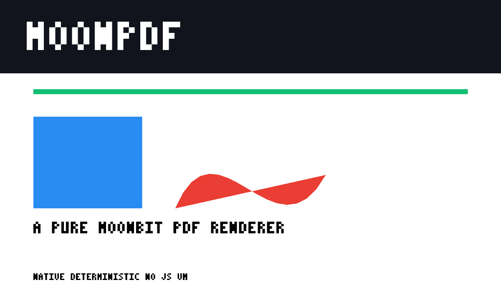

# MoonPDF

**A pure-MoonBit PDF page rendering engine.** Parse a PDF, interpret its content
stream, rasterize the page, and write a PNG — without a JavaScript VM, a C
library, or a browser.

MoonPDF is an original implementation built for the MoonBit ecosystem. It is not
a binding and not a port of an existing renderer: the parser, graphics state,
path flattening, scanline rasterizer and PNG encoder are written in MoonBit.

## Why this exists

MoonBit already has excellent PDF **document** tooling:

- [`moonbitlang/pdflite`](https://mooncakes.io/docs/moonbitlang/pdflite) reads,
  writes and manipulates PDF objects and extracts text;
- [`moonbitlang/pagelayout`](https://mooncakes.io/docs/moonbitlang/pagelayout)
  generates paginated documents and PDF/SVG output;
- the official office viewer renders PDF previews by shipping **PDF.js** into
  the browser.

What the ecosystem does not have is the last mile: a native **page rasterizer**.
Any MoonBit application that needs a thumbnail, a page image for OCR or a
visual regression check currently has to embed a JavaScript engine or call out
to an external binary. MoonPDF closes that gap with a small, inspectable,
multi-target rendering core.

## Status

This repository is at the **initial-review vertical slice** stage. It already
renders real pages end to end:

| Area | Current support |
| --- | --- |
| PDF syntax | classic xref tables, indirect objects, dictionaries, arrays, names, strings, streams |
| Page tree | inherited `MediaBox` / `Resources`, multiple pages |
| Content | `q/Q/cm`, path construction (`m l c v y re h`), fill/stroke (`S s f F f* B B* b b* n`), RGB/gray/CMYK, line width/cap |
| Text | text state, `Td/TD/Tm/T*`, `Tj/TJ/'/"`, fallback bitmap glyphs |
| Output | RGB PNG with zlib compression |

The renderer is deliberately explicit about what it does **not** support yet:
Flate-compressed content streams, xref streams, object streams, embedded font
outlines, images, clipping, transparency and shadings. See
[`docs/compatibility.md`](docs/compatibility.md).



## Quick start

Requirements: the MoonBit toolchain (`moon 0.1.20261102` or newer) and Node.js
is **not** required.

```sh
moon check
moon test
moon run cmd/moonpdf -- fixtures/shapes.pdf out.png --scale 2
```

The CLI:

```text
moonpdf <input.pdf> [output.png] [--page N] [--scale S]
```

`--scale 1.0` means 72 dpi; `--scale 2` produces a 144 dpi image.

## Architecture

```text
bytes
  │
  ├─ pdf/        lexer, object parser, classic xref, page tree
  │
  ├─ render/     content-stream interpreter, graphics state, text state
  │    ├─ path    Bézier flattening
  │    ├─ canvas  supersampled scanline fill / stroke
  │    ├─ font    3×5 fallback glyphs
  │    └─ png     zlib + PNG chunks + CRC32
  │
  └─ cmd/moonpdf CLI
```

The parser and the renderer are separate packages so that document inspection
tools can use the object model without pulling in the rasterizer. The public
facade is `Yjh4899/moonpdf`; `page_count` and `render_page_png` are the stable
entry points.

Design rules:

1. **Fail loudly.** Malformed input raises a typed error instead of being
   silently repaired. Recovery policies, when added, will be explicit APIs.
2. **No hidden runtime.** No FFI, no JS VM, no external process.
3. **Small, testable layers.** Every layer has unit tests and a narrow public
   surface.
4. **Measure the unsupported surface.** The compatibility matrix is part of the
   product, not an afterthought.

## Testing

```sh
moon test                 # 13 unit tests across parser, content, raster, PNG
moon run cmd/moonpdf -- fixtures/text.pdf out/text.png --scale 2
```

CI runs `moon fmt --check`, `moon check --deny-warn`, `moon test`, renders both
fixtures and verifies the PNG signature and dimensions.

The fixtures are generated by [`tools/make_fixtures.py`](tools/make_fixtures.py)
and intentionally use uncompressed content streams so that the first vertical
slice is exercised without a decompressor.

## Roadmap

| Milestone | Goal |
| --- | --- |
| M0 (this repository) | vector graphics + fallback text + PNG, strict errors, CI |
| M1 | FlateDecode (zlib), xref streams, object streams, images (JPEG/PNG) |
| M2 | embedded TrueType/CFF glyph outlines, correct text metrics, font cache |
| M3 | clipping, transparency groups, shadings, patterns, SVG output |
| M4 | differential corpus against MuPDF, performance pass, wasm demo |

The full plan, scope boundaries and acceptance criteria are in
[`docs/scope.md`](docs/scope.md) and [`docs/roadmap.md`](docs/roadmap.md).

## References and license

- PDF 32000-1:2008, *Document management — Portable Document Format*.
- Behavioral reference implementations: MuPDF, PDFium and Poppler. No source
  code from those projects is copied; MoonPDF is implemented from the
  specification and from black-box output comparisons.
- `moonbitlang/pdflite` and `moonbitlang/office` are complementary MoonBit
  projects; MoonPDF does not vendor or re-export their code.

MoonPDF is licensed under the Apache License 2.0. See [LICENSE](LICENSE).

## AI-assisted development

AI tools are used for scaffolding, test generation and review. Architecture,
scope decisions and correctness checks remain explicit and reviewable. The
development log and the reasoning behind key trade-offs are recorded in
[`docs/decisions.md`](docs/decisions.md).
