# MoonPDF

[](https://github.com/Yjh4899/moonpdf/actions/workflows/ci.yml)
[](https://mooncakes.io/docs/Yjh4899/moonpdf)

[绠€浣撲腑鏂嘳(README.zh.md)

**A pure-MoonBit PDF page rendering engine.** Parse a PDF, interpret its content
stream, rasterize the page, and write a PNG without a JavaScript VM, a C
library, or a browser.

Published as [`Yjh4899/moonpdf@0.42.0`](https://mooncakes.io/docs/Yjh4899/moonpdf)
on mooncakes.io.

## Why this exists

MoonBit already has PDF document tooling: `moonbitlang/pdflite` reads, writes and
manipulates PDF objects, `moonbitlang/pagelayout` generates pages, and the
official office viewer renders PDF previews by shipping PDF.js into the browser.

What the ecosystem does not have is the last mile: a native page rasterizer. Any
MoonBit application that needs a thumbnail, a page image for OCR or a visual
regression check currently has to embed a JavaScript engine or call out to an
external binary. MoonPDF closes that gap with a small, inspectable, multi-target
rendering core.

## Status

This repository is at the **images and page-geometry milestone**. It renders
real pages end to end, including incrementally saved files:

| Area | Current support |
| --- | --- |
| File structure | classic xref, xref streams, object streams, hybrid `/XRefStm`, incremental updates (`/Prev`) |
| Filters | Flate, ASCIIHex, ASCII85, RunLength, LZW; TIFF/PNG predictors |
| Page tree | inherited `MediaBox` / `Resources`, `/Rotate`, `/CropBox`, multiple pages |
| Content | `q/Q/cm`, paths (`m l c v y re h`), fill/stroke, RGB/gray/CMYK, line width/cap |
| Clip | exact `W` / `W*` path masks, Form `BBox` |
| Forms | Form XObjects with `/Matrix`, nested resources and `BBox` clip |
| Images | 8-bit gray/RGB/CMYK, Flate and baseline JPEG, inline images, `/SMask` alpha |
| Text | text state, `Td/TD/Tm/T*`, `Tj/TJ/'/"`, embedded TrueType/CFF/Type1 outlines (PFB/PFA, Type1 `seac`), standard-14 AFM metrics and kerning, Type0/CIDFontType2, CID-keyed CFF, embedded and named CJK CMaps, bitmap fallback |
| Transparency | constant `ca`/`CA` alpha, `BM` blend modes, isolated form groups and ExtGState soft masks |
| Shading | axial/radial `sh` (types 2/3) with type 2 exponential functions |
| Patterns | shading patterns (`PatternType 2`), colored and uncolored tiling patterns (`PatternType 1`) |
| Annotations | static `/AP /N` forms, widget `/AS` states and Hidden/NoView flags |
| Optional content | hidden OCGs from `/OCProperties /D` and `/OC` BDC |
| Output | RGB PNG; SVG (`--svg`) with vector paths/images/clips/text and PNG fallback |

The target is ISO 32000-1:2008 page rendering. See
[`docs/standard-coverage.md`](docs/standard-coverage.md) for the clause-level
target and corpus gate, and [`docs/incremental-updates.md`](docs/incremental-updates.md)
for the `/Prev` algorithm and the reused-resource fixture.

Still missing, and tracked as milestones: vertical CJK writing mode,
progressive JPEG and soft masks, transparency, shadings and annotation
appearance streams. See [`docs/compatibility.md`](docs/compatibility.md).

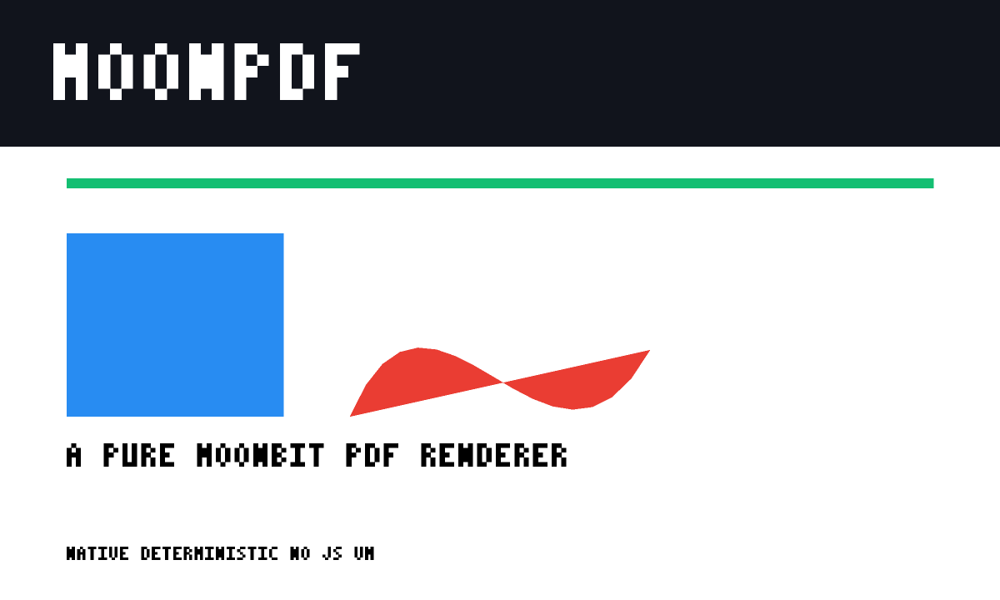

An incremental revision reusing the old Form XObject header and the old
font/resources, with a newly appended body stream:

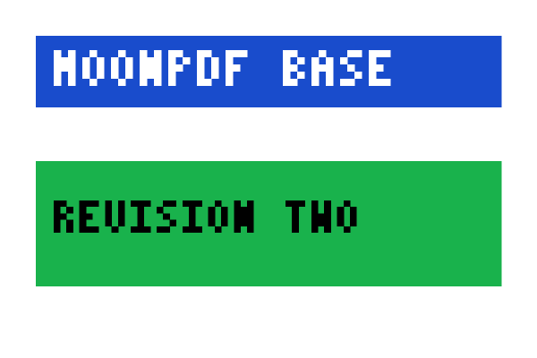

A baseline JPEG image XObject with 4:2:0 chroma subsampling, decoded by the
in-tree JPEG decoder:

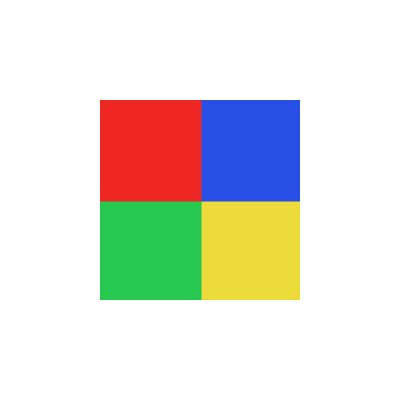

Embedded OpenSans (OFL) rendered from `FontFile2` `glyf` outlines and `hmtx`
advances:

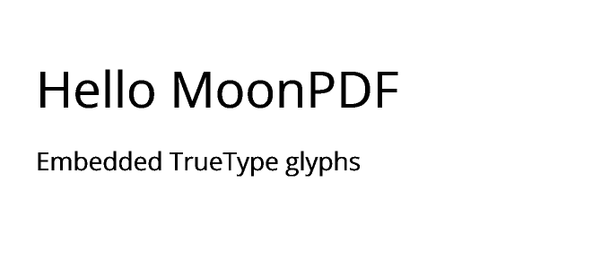

Embedded Source Sans 3 (OFL) rendered from CFF Type 2 charstrings:

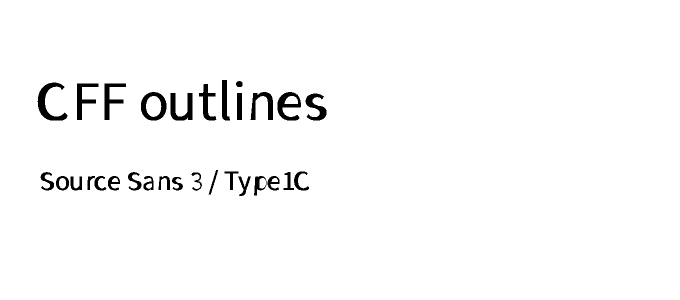

Type0 / `CIDFontType2` with Identity-H, two-byte codes and an explicit
`/CIDToGIDMap`:


Type1 (`/FontFile`) Latin Modern Roman, including eexec and charstring
decryption:

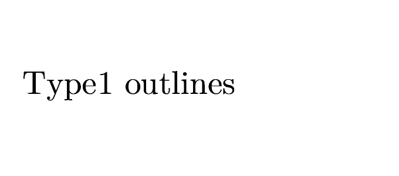

PFA Type1 with a hexadecimal `eexec` section:

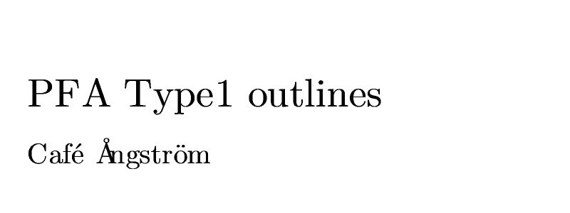

CID-keyed CFF with Identity-H CIDs and CJK glyphs (Noto Sans CJK SC subset):


Constant alpha from `ExtGState` (`/ca 0.5`): blue over red produces purple in
the overlap:

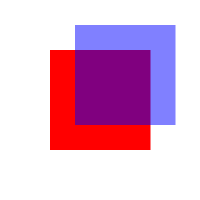

`/BM /Multiply`: yellow 脳 blue becomes black in the overlap:

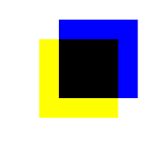

Exact `W` path clipping: a blue fill restricted to a triangular clip path.

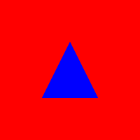

Axial shading (`sh`) from red to blue:

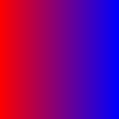

Shading pattern (`PatternType 2`) clipped to a filled rectangle:


Colored tiling pattern (`PatternType 1`): a recursive 20脳20 cell repeated
across the page.

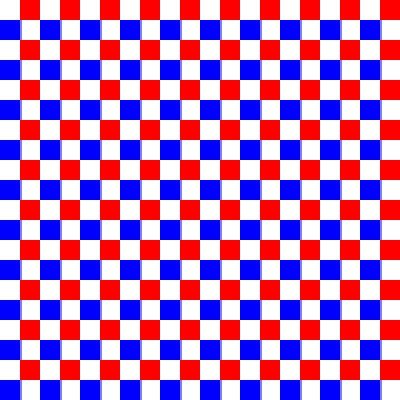

Uncolored tiling pattern (`PaintType 2`), tinted red by the `scn` color:

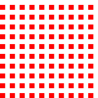

Static annotation appearance stream (`/AP /N` form) composited over the page:


Widget appearance states: `/AS /On` renders green, `/AS /Off` renders red.


Hidden optional-content group: the green layer inside `/OC ... BDC` is skipped,
leaving the red page.


Annotation flag `/F 2` (Hidden): the red widget is skipped, the green one stays.


Image `/SMask` alpha: opaque red on the left, fading into the blue page on the
right.

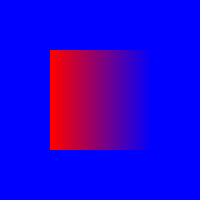

Isolated transparency group at 50% group alpha over a blue page:


ExtGState luminosity soft mask: the red fill is visible only on the white half of
the mask, leaving blue on the right.

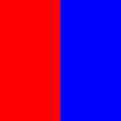

## Quick start

Requirements: the MoonBit toolchain (`moon 0.1.20261102` or newer). Node.js is
not required.

```sh
moon check
moon test
moon run cmd/moonpdf -- fixtures/shapes.pdf out.png --scale 2
```

The default target is `wasm-gc`, so the CLI runs on any machine with the MoonBit
toolchain. Add `--target native` for maximum throughput; on Windows the native
backend requires MSVC Build Tools.

The CLI:

```text
moonpdf <input.pdf> [output] [--page N | --all | --pages LIST]
        [--out-dir DIR] [--scale S] [--svg]
```

`--scale 1.0` means 72 dpi; `--scale 2` produces a 144 dpi image. `--pages`
accepts comma-separated pages and ranges:

```sh
moonpdf report.pdf --pages 1,3-5 --out-dir out --scale 2
moonpdf report.pdf --all --out-dir out --svg
```

Batch output is named `page-001.png`, `page-002.svg`, ... inside `--out-dir`.

## Architecture

```text
bytes
  |
  +-- pdf/        lexer, object parser, xref chain, filters, page tree
  |
  +-- render/     content interpreter, graphics state, forms, text, images
  |    +-- path    Bezier flattening
  |    +-- canvas  supersampled scanline fill / stroke
  |    +-- font    3x5 fallback glyphs
  |    +-- image   image XObject sampling, baseline JPEG
  |    +-- png     zlib + PNG chunks + CRC32
  |
  +-- cmd/moonpdf CLI
```

The parser and renderer are separate packages so that document inspection tools
can use the object model without pulling in the rasterizer. The public facade is
`Yjh4899/moonpdf`; `page_count` and `render_page_png` are the stable entry points.

Design rules:

1. **Fail loudly.** Malformed input raises a typed error instead of being
   silently repaired. Recovery policies, when added, will be explicit APIs.
2. **No hidden runtime.** No FFI, no JS VM, no external process.
3. **Small, testable layers.** Every layer has unit tests and a narrow public
   surface.
4. **Measure the unsupported surface.** The compatibility matrix is part of the
   product, not an afterthought.

## Testing

```sh
moon test                 # 56 unit and integration tests
moon run cmd/moonpdf -- fixtures/text.pdf out/text.png --scale 2
```

CI runs `moon fmt --check`, `moon check --deny-warn`, `moon test`, renders all
fixtures and checks PNG dimensions and sampled pixels.

The fixtures are generated by scripts under [`tools/`](tools) and committed so
that CI can reproduce every render.

### Corpus and differential testing

`tools/corpus_check.py` renders a directory of PDFs and, when PyMuPDF is
available, compares each page against its rasterizer:

```sh
python tools/corpus_check.py --pdf-dir fixtures --out docs/corpus-report.md
python tools/corpus_check.py --pdf-dir corpus --download --out docs/corpus-report-real.md
```

The checked-in reports record render success, per-file time, MAE and the fraction
of pixels within 8 RGB levels:

- [`docs/corpus-report.md`](docs/corpus-report.md): 39 committed fixtures, all
  render; 33 are within tolerance, 3 differ because the reference renderer does
  not paint the relevant annotation/pattern fixtures.
- [`docs/corpus-report-real.md`](docs/corpus-report-real.md): 13 downloaded
  public PDFs (papers, government forms, transparency/blend samples). Three pass
  the pixel tolerance and ten are tracked fidelity gaps; all render without
  crash or timeout.

Downloaded PDFs live in `corpus/` and are gitignored; only
[`corpus/manifest.json`](corpus/manifest.json) and the checker are committed.

### Fuzz and robustness

[`tools/fuzz_pdf.py`](tools/fuzz_pdf.py) generates truncations, bit
flips, random bytes and targeted semantic corruptions (huge page, huge image,
recursive form, page-tree cycle), then runs the CLI with a timeout.

Current run: **120 cases, 0 crashes, 0 timeouts**, 101 controlled errors and 19
valid renders. See [`docs/fuzz-report.md`](docs/fuzz-report.md). The
semantic cases are also part of CI.

Resource guards reject pages/images above 64 megapixels and page trees deeper
than 64 nodes, keeping malformed input from exhausting memory or the stack.

### Performance

[`tools/bench.py`](tools/bench.py) runs a fixed set of fixtures at scale 1/2 and
reports median wall time:

```sh
python tools/bench.py --reps 3 --out docs/performance.md
```

The checked-in [`docs/performance.md`](docs/performance.md) records the machine,
command, PNG sizes and per-case medians. Numbers include `moon run` startup, so
they are for relative tracking; pass a built executable via `--cli` for
throughput measurements.

## Roadmap

| Milestone | Goal |
| --- | --- |
| M0 (delivered) | file structure, filters, incremental updates, vector graphics |
| M1 (delivered) | images, inline images, Rotate/CropBox, rectangular clipping |
| M2 (delivered) | embedded TrueType/CFF/Type1, standard-14 metrics/kerning, Type0/CIDFontType2, CID-keyed CFF, embedded and named CJK CMaps |
| M3 (current) | alpha, blend modes, exact clipping, shadings, patterns, annotations, flags, optional content, image/ExtGState soft masks, isolated transparency groups and vector SVG paths/images/clips/text delivered; standard-14 vector text |
| M4 (started) | corpus/differential harness, fuzz robustness, performance baseline, single-parse document handle, multi-page CLI, 13-PDF real corpus, graphics-state copy fix, text-advance fix, raw CFF SID mapping, BT/ET font persistence, stitching shadings, full-pixel page rounding, HSL blend modes, gamma-aware downsampling |
| M4 | corpus SSIM vs MuPDF, performance pass, wasm demo |

The full plan, scope boundaries and acceptance criteria are in
[`docs/scope.md`](docs/scope.md) and [`docs/roadmap.md`](docs/roadmap.md).

## References and license

- PDF 32000-1:2008, *Document management: Portable Document Format*.
- Behavioral reference implementations: MuPDF, PDFium and Poppler. No source
  code from those projects is copied; MoonPDF is implemented from the
  specification and from black-box output comparisons.
- `moonbitlang/pdflite` and `moonbitlang/office` are complementary MoonBit
  projects; MoonPDF does not vendor or re-export their code.

MoonPDF is licensed under the Apache License 2.0. See [LICENSE](LICENSE).

## AI-assisted development

AI tools are used for scaffolding, test generation and review. Architecture,
scope decisions and correctness checks remain explicit and reviewable. The
development log and the reasoning behind key trade-offs are recorded in
[`docs/decisions.md`](docs/decisions.md).
