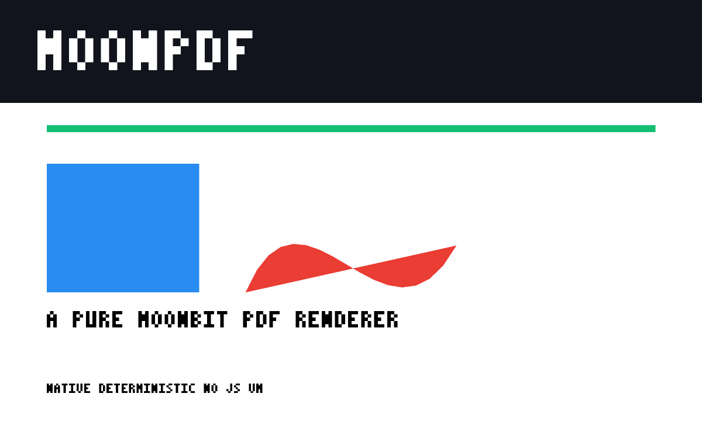

# MoonPDF

[English](README.md) | 简体中文

**纯 MoonBit 的 PDF 页面渲染引擎**：解析 PDF、解释内容流、光栅化页面并输出 PNG，不依赖 JavaScript 虚拟机、C 库或浏览器。

已发布到 mooncakes.io：[`Yjh4899/moonpdf@0.1.0`](https://mooncakes.io/docs/Yjh4899/moonpdf)。

## 为什么需要

MoonBit 生态已经能“读写 PDF”：`pdflite`/`mbtpdf` 负责对象解析与改写，`pagelayout` 负责生成，官方 office-viewer 的 PDF 预览则直接嵌入 PDF.js。缺的是“把某一页变成像素”的最后一公里。MoonPDF 用纯 MoonBit 补齐这一层，可用于缩略图、OCR 前置、桌面预览和文档视觉回归。

## 当前状态

已打通端到端垂直切片：经典 xref、间接对象、页面树、内容流解释、路径填充/描边、RGB/灰度/CMYK、文本状态与回退字形、2× 超采样扫描线光栅化、PNG 输出、CLI、13 个单元测试与 CI。



## 快速开始

```sh
moon check
moon test
moon run cmd/moonpdf -- fixtures/demo.pdf out.png --scale 2
```

默认目标是 `wasm-gc`；加 `--target native` 可获得更高吞吐（Windows 原生后端需要 MSVC Build Tools）。

## 文档

- [架构](docs/architecture.md)
- [范围与验收](docs/scope.md)
- [兼容性矩阵](docs/compatibility.md)
- [路线图](docs/roadmap.md)
- [项目申报书](docs/proposal.zh.md)

## 许可

Apache-2.0。参考 PDF 32000-1:2008 规范与 MuPDF/PDFium/Poppler 的公开行为，不复制其源码。
