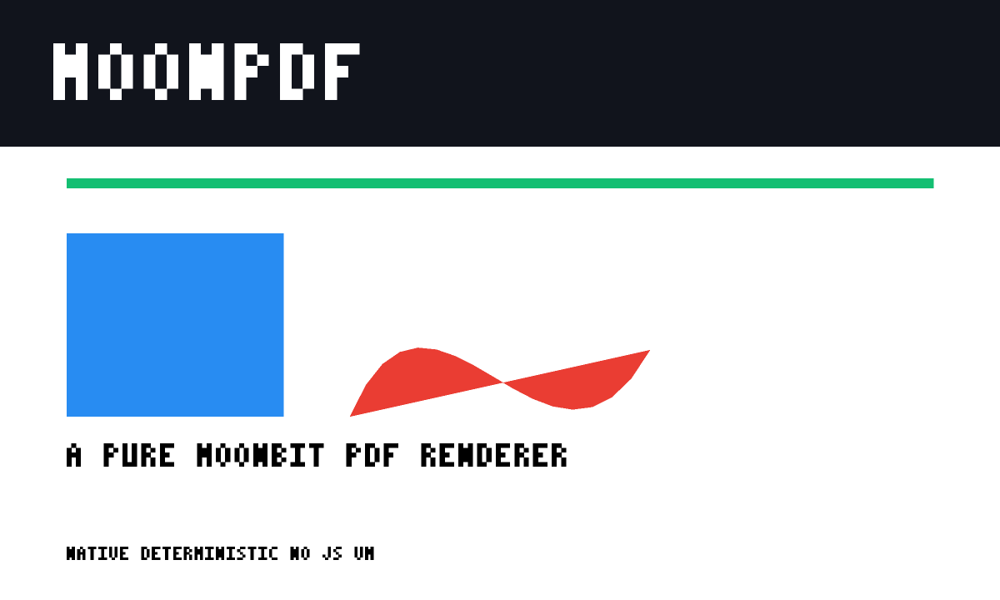
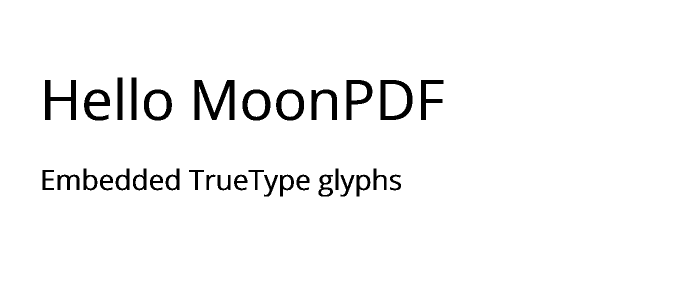
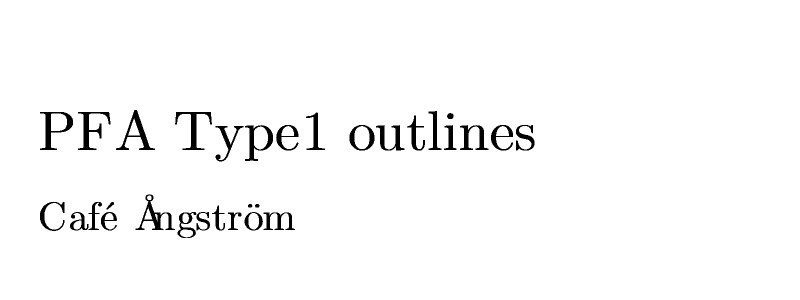
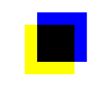
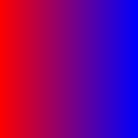
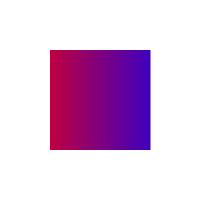
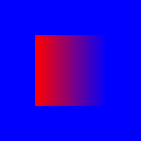

# MoonPDF

[English](README.md) | 简体中文

**纯 MoonBit 的 PDF 页面渲染引擎**：解析 PDF、解释内容流、光栅化页面并输出 PNG，不依赖 JavaScript 虚拟机、C 库或浏览器。

已发布到 mooncakes.io：[`Yjh4899/moonpdf@0.41.0`](https://mooncakes.io/docs/Yjh4899/moonpdf)。

## 为什么需要

MoonBit 生态已经能“读写 PDF”：`pdflite`/`mbtpdf` 负责对象解析与改写，`pagelayout` 负责生成，官方 office-viewer 的 PDF 预览则直接嵌入 PDF.js。缺的是“把某一页变成像素”的最后一公里。MoonPDF 用纯 MoonBit 补齐这一层，可用于缩略图、OCR 前置、桌面预览和文档视觉回归。

## 当前状态

已完成字体与文本里程碑的 TrueType 与 CFF 部分：经典 xref、xref stream、object stream、混合 `/XRefStm`、增量更新（`/Prev`）、Flate/ASCIIHex/ASCII85/RunLength/LZW、Form XObject、图像 XObject（灰度/RGB/CMYK、Flate、基线 JPEG）、内联图像、`/Rotate`、`/CropBox`、矩形裁剪、嵌入 TrueType（`FontFile2` 的 cmap/hmtx/glyf，含复合字形）、嵌入 CFF（`FontFile3` Type1C 的 INDEX/DICT/Type 2 charstrings）、标准 14 字体度量与 ASCII kerning（Helvetica/Times/Courier AFM）、Type0 / CIDFontType2（Identity-H、`/CIDToGIDMap`）、Type1（`FontFile` 的 PFB/PFA eexec，含 PFA hex eexec、charstring 与 `seac` 重音）、CID-keyed CFF（`CIDFontType0` 的 charset/FDArray/FDSelect）、嵌入 Type0 编码 CMap（`begincidrange`）、具名 Adobe CJK CMap（UniGB/UniJIS/UniKS/UniCNS UCS2）、ExtGState 常量 alpha（`ca`/`CA`）与 blend modes（`/BM`）、精确 `W`/`W*` 路径裁剪、轴向/径向 shading（`sh`）、shading pattern（`PatternType 2`）与彩色/uncolored tiling pattern（`PatternType 1`）、静态 annotation appearance（`/AP /N`）与 widget `/AS` 状态、隐藏 optional content（`/OC` BDC）、annotation Hidden/NoView 标志、图像 `/SMask` alpha、SVG 容器输出（内嵌 PNG）与 path-only 页面的矢量 SVG（含图像、裁剪与嵌入字体文本）、隔离透明组、ExtGState soft mask、页面树、内容流解释、路径填充/描边、RGB/灰度/CMYK、文本状态与回退字形、2× 超采样、PNG、CLI、56 个单元/集成测试与 CI、corpus/差分测试工具。



增量修订复用旧 Form XObject 页眉并追加新主体：


基线 JPEG 图像 XObject（带 4:2:0 色度抽样）：


嵌入 OpenSans（OFL）的 TrueType 字形轮廓：



嵌入 Source Sans 3（OFL）的 CFF Type 2 charstring 轮廓：


Type0 / `CIDFontType2`（Identity-H、双字节编码、`/CIDToGIDMap`）：


Type1（`/FontFile`）Latin Modern Roman，含 eexec 与 charstring 解密：


PFA Type1，hex `eexec` 段：



CID-keyed CFF（Identity-H CID、CJK 字形，Noto Sans CJK SC 子集）：


ExtGState 常量 alpha（`/ca 0.5`）：蓝色叠在红色上，重叠处变紫：


`/BM /Multiply`：黄色 × 蓝色，重叠处变黑：



精确 `W` 路径裁剪：蓝色填充被限制在三角形裁剪路径内。


轴向 shading（`sh`），从红到蓝：



shading pattern（`PatternType 2`）填充矩形：



彩色 tiling pattern（`PatternType 1`）：20×20 单元格递归渲染后平铺。


uncolored tiling pattern（`PaintType 2`），按 `scn` 颜色染成红色：


静态 annotation appearance（`/AP /N` form）叠加到页面上：


Widget 外观状态：`/AS /On` 显示绿色，`/AS /Off` 显示红色。


隐藏 optional content：`/OC ... BDC` 内的绿色层被跳过，只留下红色页面。


annotation `/F 2`（Hidden）：红色 widget 被跳过，只保留绿色。


图像 `/SMask` alpha：左侧红色不透明，向右逐渐过渡到蓝色页面。



隔离透明组：组内内容先独立合成，再以 50% 组 alpha 叠到蓝色页面上。


ExtGState luminosity soft mask：红色只出现在 mask 的白色半边，右半边保留蓝色。


## 快速开始

```sh
moon check
moon test
moon run cmd/moonpdf -- fixtures/demo.pdf out.png --scale 2
```

默认目标是 `wasm-gc`；加 `--target native` 可获得更高吞吐（Windows 原生后端需要 MSVC Build Tools）。

## 文档

- [标准覆盖目标](docs/standard-coverage.md)
- [增量更新解析](docs/incremental-updates.md)
- [架构](docs/architecture.md)
- [范围与验收](docs/scope.md)
- [兼容性矩阵](docs/compatibility.md)
- [路线图](docs/roadmap.md)
- [项目申报书](<docs/申报书.md>)

## 许可

Apache-2.0。参考 PDF 32000-1:2008 规范与 MuPDF/PDFium/Poppler 的公开行为，不复制其源码。嵌入字体 fixture 使用 OpenSans 与 Source Sans 3（SIL OFL 1.1），许可证见 `fixtures/fonts/`。
