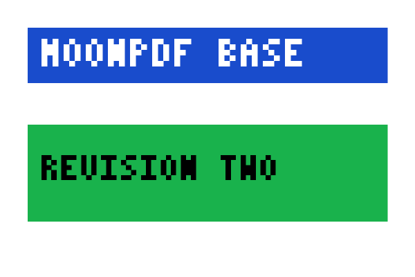
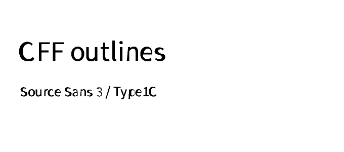
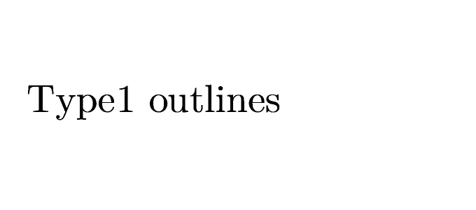
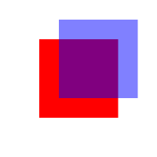
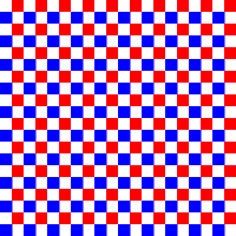

# MoonPDF

[English](README.md) | 绠€浣撲腑鏂?
**绾?MoonBit 鐨?PDF 椤甸潰娓叉煋寮曟搸**锛氳В鏋?PDF銆佽В閲婂唴瀹规祦銆佸厜鏍呭寲椤甸潰骞惰緭鍑?PNG锛屼笉渚濊禆 JavaScript 铏氭嫙鏈恒€丆 搴撴垨娴忚鍣ㄣ€?
宸插彂甯冨埌 mooncakes.io锛歔`Yjh4899/moonpdf@0.21.1`](https://mooncakes.io/docs/Yjh4899/moonpdf)銆?
## 涓轰粈涔堥渶瑕?
MoonBit 鐢熸€佸凡缁忚兘鈥滆鍐?PDF鈥濓細`pdflite`/`mbtpdf` 璐熻矗瀵硅薄瑙ｆ瀽涓庢敼鍐欙紝`pagelayout` 璐熻矗鐢熸垚锛屽畼鏂?office-viewer 鐨?PDF 棰勮鍒欑洿鎺ュ祵鍏?PDF.js銆傜己鐨勬槸鈥滄妸鏌愪竴椤靛彉鎴愬儚绱犫€濈殑鏈€鍚庝竴鍏噷銆侻oonPDF 鐢ㄧ函 MoonBit 琛ラ綈杩欎竴灞傦紝鍙敤浜庣缉鐣ュ浘銆丱CR 鍓嶇疆銆佹闈㈤瑙堝拰鏂囨。瑙嗚鍥炲綊銆?
## 褰撳墠鐘舵€?
宸插畬鎴愬瓧浣撲笌鏂囨湰閲岀▼纰戠殑 TrueType 涓?CFF 閮ㄥ垎锛氱粡鍏?xref銆亁ref stream銆乷bject stream銆佹贩鍚?`/XRefStm`銆佸閲忔洿鏂帮紙`/Prev`锛夈€丗late/ASCIIHex/ASCII85/RunLength/LZW銆丗orm XObject銆佸浘鍍?XObject锛堢伆搴?RGB/CMYK銆丗late銆佸熀绾?JPEG锛夈€佸唴鑱斿浘鍍忋€乣/Rotate`銆乣/CropBox`銆佺煩褰㈣鍓€佸祵鍏?TrueType锛坄FontFile2` 鐨?cmap/hmtx/glyf锛屽惈澶嶅悎瀛楀舰锛夈€佸祵鍏?CFF锛坄FontFile3` Type1C 鐨?INDEX/DICT/Type 2 charstrings锛夈€佹爣鍑?14 瀛椾綋搴﹂噺涓?ASCII kerning锛圚elvetica/Times/Courier AFM锛夈€乀ype0 / CIDFontType2锛圛dentity-H銆乣/CIDToGIDMap`锛夈€乀ype1锛坄FontFile` 鐨?PFB/PFA eexec銆乧harstring 涓?`seac` 閲嶉煶锛夈€丆ID-keyed CFF锛坄CIDFontType0` 鐨?charset/FDArray/FDSelect锛夈€佸祵鍏?Type0 缂栫爜 CMap锛坄begincidrange`锛夈€佸叿鍚?Adobe CJK CMap锛圲niGB/UniJIS/UniKS/UniCNS UCS2锛夈€丒xtGState 甯搁噺 alpha锛坄ca`/`CA`锛変笌 blend modes锛坄/BM`锛夈€佺簿纭?`W`/`W*` 璺緞瑁佸壀銆佽酱鍚?寰勫悜 shading锛坄sh`锛夈€乻hading pattern锛坄PatternType 2`锛変笌褰╄壊 tiling pattern锛坄PatternType 1`锛夈€侀潤鎬?annotation appearance锛坄/AP /N`锛夈€侀〉闈㈡爲銆佸唴瀹规祦瑙ｉ噴銆佽矾寰勫～鍏?鎻忚竟銆丷GB/鐏板害/CMYK銆佹枃鏈姸鎬佷笌鍥為€€瀛楀舰銆?脳 瓒呴噰鏍枫€丳NG銆丆LI銆?3 涓崟鍏?闆嗘垚娴嬭瘯涓?CI銆?


澧為噺淇澶嶇敤鏃?Form XObject 椤电湁骞惰拷鍔犳柊涓讳綋锛?


鍩虹嚎 JPEG 鍥惧儚 XObject锛堝甫 4:2:0 鑹插害鎶芥牱锛夛細


宓屽叆 OpenSans锛圤FL锛夌殑 TrueType 瀛楀舰杞粨锛?


宓屽叆 Source Sans 3锛圤FL锛夌殑 CFF Type 2 charstring 杞粨锛?


Type0 / `CIDFontType2`锛圛dentity-H銆佸弻瀛楄妭缂栫爜銆乣/CIDToGIDMap`锛夛細


Type1锛坄/FontFile`锛塋atin Modern Roman锛屽惈 eexec 涓?charstring 瑙ｅ瘑锛?


CID-keyed CFF锛圛dentity-H CID銆丆JK 瀛楀舰锛孨oto Sans CJK SC 瀛愰泦锛夛細


ExtGState 甯搁噺 alpha锛坄/ca 0.5`锛夛細钃濊壊鍙犲湪绾㈣壊涓婏紝閲嶅彔澶勫彉绱細



`/BM /Multiply`锛氶粍鑹?脳 钃濊壊锛岄噸鍙犲鍙橀粦锛?


绮剧‘ `W` 璺緞瑁佸壀锛氳摑鑹插～鍏呰闄愬埗鍦ㄤ笁瑙掑舰瑁佸壀璺緞鍐呫€?


shading pattern锛坄PatternType 2`锛夊～鍏呯煩褰細


褰╄壊 tiling pattern锛坄PatternType 1`锛夛細20脳20 鍗曞厓鏍奸€掑綊娓叉煋鍚庡钩閾恒€?


闈欐€?annotation appearance锛坄/AP /N` form锛夊彔鍔犲埌椤甸潰涓婏細


## 蹇€熷紑濮?
```sh
moon check
moon test
moon run cmd/moonpdf -- fixtures/demo.pdf out.png --scale 2
```

榛樿鐩爣鏄?`wasm-gc`锛涘姞 `--target native` 鍙幏寰楁洿楂樺悶鍚愶紙Windows 鍘熺敓鍚庣闇€瑕?MSVC Build Tools锛夈€?
## 鏂囨。

- [鏍囧噯瑕嗙洊鐩爣](docs/standard-coverage.md)
- [澧為噺鏇存柊瑙ｆ瀽](docs/incremental-updates.md)
- [鏋舵瀯](docs/architecture.md)
- [鑼冨洿涓庨獙鏀禲(docs/scope.md)
- [鍏煎鎬х煩闃礭(docs/compatibility.md)
- [璺嚎鍥綸(docs/roadmap.md)
- [椤圭洰鐢虫姤涔(<docs/鐢虫姤涔?md>)

## 璁稿彲

Apache-2.0銆傚弬鑰?PDF 32000-1:2008 瑙勮寖涓?MuPDF/PDFium/Poppler 鐨勫叕寮€琛屼负锛屼笉澶嶅埗鍏舵簮鐮併€傚祵鍏ュ瓧浣?fixture 浣跨敤 OpenSans 涓?Source Sans 3锛圫IL OFL 1.1锛夛紝璁稿彲璇佽 `fixtures/fonts/`銆?