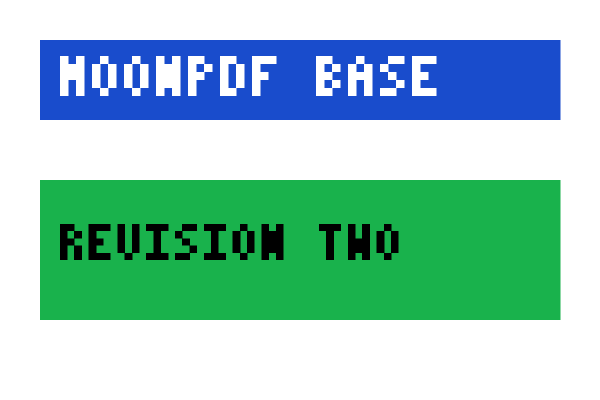

# MoonPDF 项目申报书

## 基本信息
- **项目名称**：MoonPDF：MoonBit 原生 PDF 页面渲染引擎
- **GitHub**：https://github.com/Yjh4899/moonpdf
- **mooncakes**：https://mooncakes.io/docs/Yjh4899/moonpdf
- **方向**：文档处理引擎 / 图形与渲染基础设施
- **类型**：原创

## 项目简介
当前生态缺失原生的页面光栅化（渲染为像素）能力。这导致开发者在实现缩略图生成、OCR 图像预处理或视觉回归测试等功能时，不得不引入 JS 虚拟机，或依赖外部二进制程序，影响了运行效率与跨平台体验。
MoonPDF 用纯 MoonBit 完成 **对象解析 → 内容流解释 → 图形状态与路径 → 扫描线光栅化 → PNG**，无 FFI、无浏览器，可编译到 native / wasm，既可作为库调用，也提供 CLI。

## 最终标准覆盖
目标是 **ISO 32000-1:2008（PDF 1.7）中与页面渲染相关的全部条款**，不是自定义子集；未完成的条款作为里程碑缺口跟踪，必须报出明确诊断，不能从范围中删除。

| 条款 | 内容 | 当前状态 |
| --- | --- | --- |
| 7.5 | 文件结构：xref 表/流、增量更新、对象流、空闲表、流过滤器 | 已完成 |
| 7.7 | 文档结构、页面树、资源继承 | 已完成 |
| 8.2–8.5 | 图形状态、路径、填充/描边、颜色空间 | 已完成 |
| 8.6–8.9 | 图像、Form XObject、内联图像、软掩码 | Form 已完成；图像 M1 |
| 8.10–8.11 | Shading、Pattern | M3 |
| 9 | 文本、字体、编码、渲染模式、Type1/TrueType/CFF、CID | 回退字形已完成；嵌入字体 M2 |
| 11 | 透明度与混合模式 | M3 |
| 12.5 / 12.2 | 注释外观流 / 可选内容可见性 | M3 |

**验收方式**：以 PDF.js 测试语料、veraPDF/MuPDF 可用测试文件和常见办公软件输出为公共语料；要求 100% 页面不崩溃/不挂起，98% 页面与 MuPDF 参考渲染的 SSIM ≥ 0.95；每个未覆盖条款必须报错并在兼容性矩阵中列出。详见 `docs/standard-coverage.md`。

## 增量更新解析方案
增量保存是合法 PDF 的常见形态（审阅、签名、批注都会追加修订）。解析器按标准 7.5.6 实现：

1. 读最后一个 `startxref`，定位到经典 xref 表或 xref stream；
2. 沿 `/Prev` 收集所有修订，拒绝循环与非正偏移；
3. 经典表带 `/XRefStm` 时解析补充 xref stream，经典表条目优先；
4. 修订按“旧 → 新”合并：后出现的条目覆盖旧条目，`f`/type 0 条目删除对象；
5. 取最新的含 `/Root` 的 trailer；
6. 先加载 type 1 偏移对象，再按 type 2 条目解码 `/ObjStm` 并解析其中的对象（对象流不可嵌套）；
7. 解码内容流（Flate/ASCIIHex/ASCII85/RunLength/LZW）后遍历最终页面树。

该路径已实现，并有 `fixtures/incremental.pdf` 与集成测试覆盖；不是“后续工作”。

## 增量保存示例：复用旧资源
`fixtures/incremental-base.pdf`（基础修订）：
- 对象 3 为页面，`/Contents 4 0 R`；对象 4 只执行 `/Logo Do`；
- 对象 8 是 Form XObject，绘制蓝色页眉与白字 `MOONPDF BASE`；
- 对象 6 为共享资源字典（字体 F1 + Logo），对象 5 为字体。

`fixtures/incremental.pdf`（增量修订）：
- **只重写对象 3**，改为 `/Contents [4 0 R 7 0 R]`；
- **追加对象 7**：绿色主体面板与 `REVISION TWO`；
- 追加第二个 xref 段，带 `/Prev` 指回基础 xref，`/Root` 不变。

对象 4（旧内容流）、对象 5（字体）、对象 6（资源字典）、对象 8（旧 Form XObject）全部**原样复用**。预期页面输出为：蓝色页眉 `MOONPDF BASE`（来自旧 Form XObject）+ 绿色主体 `REVISION TWO`（来自新增内容流）。集成测试在渲染结果上采样两个区域，分别断言蓝色与绿色像素。若忽略 `/Prev` 就找不到对象 7，主体断言失败；若忽略资源继承就丢失旧页眉。

## 已完成 / 后续 / 不做
**已完成（0.2.0）**：经典 xref、xref stream、object stream、混合 `/XRefStm`、`/Prev` 增量更新、Flate/ASCIIHex/ASCII85/RunLength/LZW、Form XObject、页面树与资源继承、路径填充/描边、RGB/灰度/CMYK、文本状态与回退字形、2× 超采样、PNG、CLI；19 个单元/集成测试、5 个 fixture、CI 渲染与像素校验。

**后续**：图像 XObject 与内联图像（M1）、嵌入 Type1/TrueType/CFF 与 CID/CJK 字体（M2）、裁剪/透明/混合/Shading/Pattern 与注释外观（M3）、公共语料 SSIM 差分。

**不做**：PDF 编辑/表单/签名/解密、JS 执行、OCR 与语义版面分析、与某一渲染器的逐像素完全一致。

## 技术路线
分层实现，每层可独立测试：字节游标与词法 → 对象解析 → xref 链与修订合并 → 过滤解码 → 页面树 → 内容流操作符 → 图形状态机/Form 展开 → 路径展平 → 扫描线填充/描边 → PNG。解析错误显式抛出；不支持的文档结构报错，不输出“看起来对”的图。字体先以回退字形锁定版面，M2 替换为轮廓字体，解释器接口不变。

## 风险与应对
- **标准覆盖大**：以条款矩阵 + 公共语料 + SSIM 门禁管理，缺口只作为里程碑，不缩小标准。
- **字体保真度**：先回退字形，后上轮廓字体与字形缓存。
- **光栅化正确性**：单元测试 + fixture 像素断言 + 后续 MuPDF 差分。
- **性能**：超采样参数可调，后续 tile 渲染与自适应曲线细分。

## 参考与许可
参考 PDF 32000-1:2008 规范及 MuPDF、PDFium、Poppler 的公开行为，不复制其源码；与 `pdflite`、`moonbitlang/office` 互补，不 vendor 其代码。项目采用 Apache-2.0。
