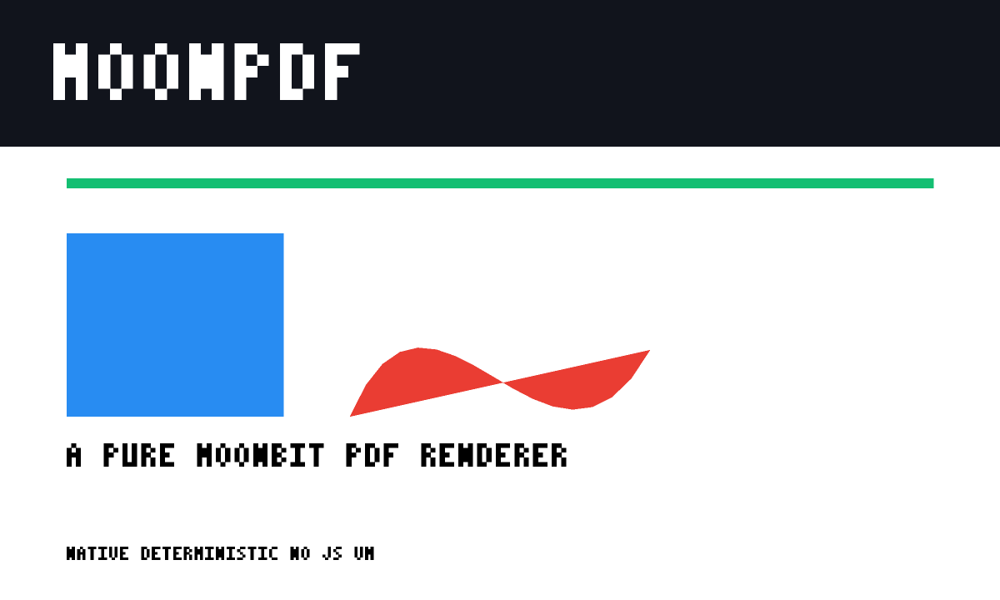
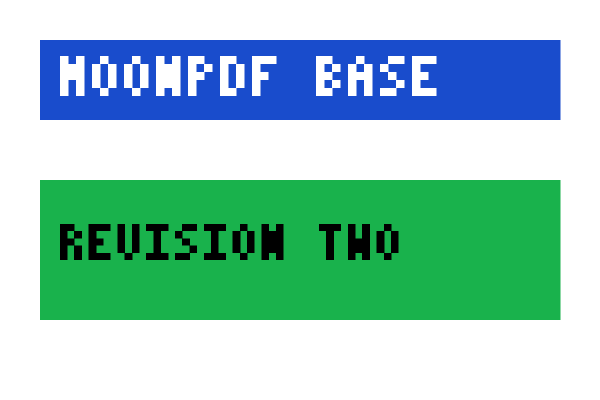
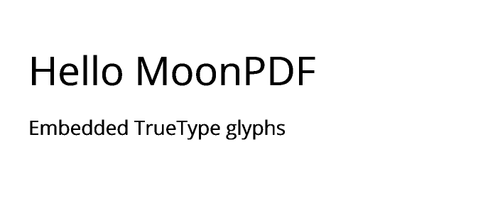
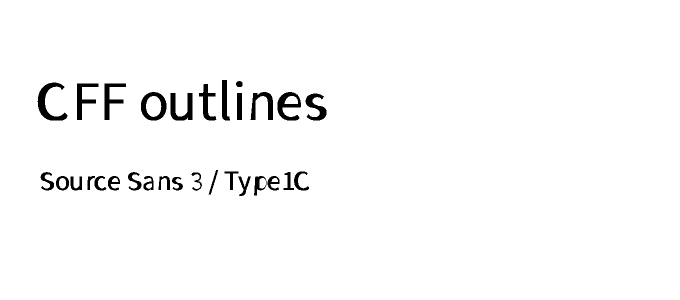
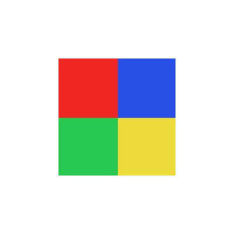
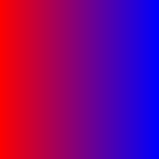
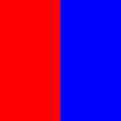

# MoonPDF examples

Run from the repository root after `moon build` is available:

```powershell
# Single page at 72 dpi
moon run cmd/moonpdf -- fixtures/demo.pdf out/demo.png --scale 2

# Every page, vector SVG where supported
moon run cmd/moonpdf -- fixtures/pages.pdf --all --out-dir out/pages --svg

# Selected pages
moon run cmd/moonpdf -- fixtures/pages.pdf --pages 1,3-5 --out-dir out/selected
```

## Gallery

| Example | Command | Image |
| --- | --- | --- |
| Demo page | `fixtures/demo.pdf` |  |
| Incremental update | `fixtures/incremental.pdf` |  |
| Embedded TrueType | `fixtures/font-embedded.pdf` |  |
| Embedded CFF | `fixtures/font-cff.pdf` |  |
| CID font | `fixtures/font-cid.pdf` |  |
| JPEG image XObject | `fixtures/image-jpeg.pdf` |  |
| Pattern | `fixtures/pattern.pdf` |  |
| Shading | `fixtures/shading.pdf` |  |
| Soft mask | `fixtures/soft-mask-extgstate.pdf` |  |

All images are generated from committed fixtures by the current renderer.

For a self-contained visual showcase, open [`demo/index.html`](../demo/index.html)
or serve `demo/` with `python -m http.server`.

## Real-document checks

```powershell
python tools/corpus_check.py --pdf-dir corpus --download `
  --out docs/corpus-report-real.md
```

The public corpus contains arXiv papers, IRS forms and PDF.js transparency and
blend samples. See [`docs/corpus-report-real.md`](../docs/corpus-report-real.md)
for per-file MAE, timing and known gaps.

## Browser / wasm

MoonPDF targets `wasm-gc` and the renderer has no filesystem or platform
dependency. The CLI is the supported entry point in 0.43.0; a browser wrapper is
future work and is tracked in [`docs/roadmap.md`](../docs/roadmap.md).
